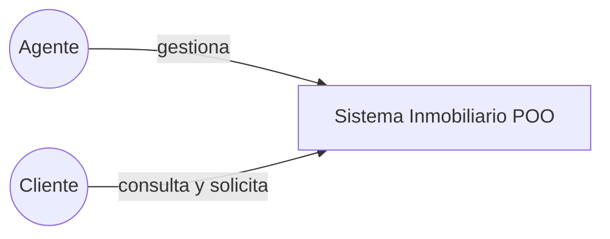

# Casos de uso

## Actores

| Actor | Descripción |
|---|---|
| **Agente** | Empleado de la inmobiliaria; gestiona inventario y atiende solicitudes |
| **Cliente** | Comprador o posible inquilino; consulta y solicita |
| **Sistema** | Validaciones, persistencia SQLite y cálculo de reglas |

## Diagrama de casos de uso (visión general)

```mermaid
flowchart TB
  subgraph PortalCliente[Portal Cliente]
    UC1[UC01 Completar / cargar perfil]
    UC2[UC02 Buscar viviendas]
    UC3[UC03 Ver detalle]
    UC4[UC04 Solicitar visita]
    UC5[UC05 Interés compra]
    UC6[UC06 Interés alquiler]
    UC7[UC07 Comprobar regla 35%]
    UC15[UC15 Mis contratos / baja]
  end

  subgraph Backoffice[Backoffice Agente]
    UC8[UC08 Alta vivienda]
    UC9[UC09 Reservar / Liberar]
    UC10[UC10 Registrar venta]
    UC11[UC11 Registrar alquiler]
    UC12[UC12 Decorar / Reformar]
    UC13[UC13 Ver informe]
    UC14[UC14 Gestionar solicitudes]
    UC16[UC16 Ver / listar contratos]
    UC17[UC17 Resolver contrato]
  end

  Cliente((Cliente)) --> UC1 & UC2 & UC3 & UC4 & UC5 & UC6 & UC7 & UC15
  Agente((Agente)) --> UC8 & UC9 & UC10 & UC11 & UC12 & UC13 & UC14 & UC16 & UC17
```

---

## Casos de uso — Cliente

### UC01 · Completar / cargar perfil
- **Precondición:** Usuario en portal Cliente.
- **Flujo A:** Introduce nombre, DNI, teléfono e ingresos → **Guardar perfil** (SQLite).
- **Flujo B:** Introduce DNI → **Cargar perfil** (recupera datos guardados).
- **Postcondición:** Sesión de cliente válida y persistida.
- **Errores:** Campos vacíos, DNI inválido, ingresos no numéricos, DNI inexistente al cargar.

### UC02 · Buscar viviendas disponibles
- **Flujo:** Opcionalmente filtra por localidad y rango de precio → Buscar disponibles.
- **Notas:** El filtro de precio admite `250000`, `250.000`, `250k` o miles cortos (`250`).
- **Postcondición:** Tabla con casas en estado `DISPONIBLE`.

### UC03 · Ver detalle
- **Precondición:** Fila seleccionada.
- **Flujo:** Ver detalle → mensaje con precio/m², estado y rentabilidad estimada.

### UC04 · Solicitar visita
- **Precondición:** Perfil completo + vivienda disponible seleccionada.
- **Flujo:** Solicitar visita → mensaje opcional → se crea solicitud `VISITA` / `PENDIENTE`.
- **Postcondición:** Visible en bandeja del agente.

### UC05 / UC06 · Interés compra o alquiler
Igual que UC04 con tipos `COMPRA` o `ALQUILER`.  
En `ALQUILER`, si la renta comprometida del cliente ya alcanza el tope del 35 %, se rechaza la solicitud.

### UC07 · Comprobar regla del 35 %
- **Flujo:** Muestra tope, renta ya comprometida y margen; pide renta adicional.
- **Resultado:** Si `renta + comprometida <= ingresos * 0.35` → elegible; si no → aviso.

### UC15 · Mis contratos / baja como arrendatario
- **Precondición:** Perfil completo y contratos vigentes del DNI.
- **Flujo:** Mis contratos → tarjeta → **Dar de baja el contrato…** → causa + observaciones.
- **Causas:** arrendatario (reparaciones, perturbación, desistimiento ≥ 6 meses) + ajenas/mutuo.
- **Postcondición:** Vivienda `DISPONIBLE`; resolución en historial SQLite.

---

## Casos de uso — Agente

### UC08 · Alta de vivienda
- **Flujo:** Nueva vivienda → formulario (dirección, CP, localidad, m², precio, hab.) → Guardar.
- **Postcondición:** Insertada en SQLite y visible en tabla.

### UC08b · Importar viviendas desde fichero
- **Flujo:** Importar datos… → explorador de archivos → elegir CSV/TXT/JSON/Excel → resumen.
- **Postcondición:** Filas válidas persistidas; inválidas listadas como error.
- **Detalle completo:** [09-importacion-datos.md](09-importacion-datos.md)

### UC09 · Reservar / Liberar
- **Reservar:** solo desde `DISPONIBLE`; exige datos del cliente y registra fecha/hora.
- **Efecto:** estado `RESERVADA`; `Reserva` persistida en SQLite.
- **Liberar:** desde `RESERVADA` o `ALQUILADA` (limpia reserva/contrato sin expediente formal).

### UC10 · Registrar venta (`comprar`)
- **Estados admitidos:** `DISPONIBLE` o `RESERVADA`.
- **Efecto:** precio final = precio × (1 + AITP); estado `VENDIDA`; limpia reserva.

### UC11 · Registrar alquiler
- **Flujo:** Datos del inquilino + renta + fianza.
- **Regla:** `renta + rentas vigentes del DNI ≤ ingresos * 0.35`.
- **Efecto:** contrato persistido; estado `ALQUILADA`.

### UC12 · Decorar / Reformar
- **Decorar:** suma coste al precio (no vende).
- **Reformar:** suma coste × (1 + IVA); estado `EN_REFORMA`.
- **Finalizar reforma:** vuelve a `DISPONIBLE`.

### UC13 · Informe de cartera
- **UI:** ventana con resumen (conteos + valor) y tarjetas agrupadas por estado.
- **RESERVADA:** muestra cliente, teléfono, ingresos y fecha/hora de reserva.
- **ALQUILADA:** muestra inquilino, renta y periodo.
- Opción **Ver texto completo** con el informe textual clásico.

### UC14 · Gestionar solicitudes
Lista solicitudes; puede marcar la primera pendiente como `ATENDIDA`.

### UC16 · Ver / listar contratos
Consulta el detalle de un alquiler o el listado de todos los contratos vigentes (tarjetas).

### UC17 · Resolver contrato (arrendador)
- **Precondición:** Vivienda `ALQUILADA` con contrato.
- **Flujo:** Resolver contrato… → causa LAU + observaciones → confirmar.
- **Causas:** arrendador (impagos, daños, obras, necesidad ≥ 12 meses, etc.) + ajenas/mutuo.
- **Postcondición:** Vivienda `DISPONIBLE`; registro en `resoluciones_contrato`.
- **Consulta:** Historial resoluciones.

---

## Reglas de negocio transversales

| ID | Regla |
|---|---|
| RN01 | CP español válido (01000–52999) |
| RN02 | Precio, m² y rentas > 0 |
| RN03 | AITP por defecto 10 % (configurable) |
| RN04 | IVA reforma 21 % |
| RN05 | Renta acumulada ≤ 35 % de ingresos del inquilino |
| RN06 | Transiciones de estado controladas por métodos de `Casa` |
| RN07 | Cliente solo opera sobre viviendas `DISPONIBLE` |
| RN08 | Toda operación de agente relevante se sincroniza a SQLite |
| RN09 | Desistimiento del inquilino: ≥ 6 meses de contrato |
| RN10 | Necesidad del propietario: ≥ 12 meses de contrato |
| RN11 | La causa de resolución debe corresponder a la iniciativa |

## Matriz actor × capacidad

| Capacidad | Agente | Cliente |
|---|---|---|
| Ver no disponibles | Sí | No |
| Alta / venta / reforma | Sí | No |
| Solicitar visita | No | Sí |
| Ver DNI de terceros | En solicitudes | Solo el suyo |
| Informe de cartera | Sí | No |
| Regla 35 % (autoevaluación) | En alquiler | Botón dedicado |
| Ver contratos propios | Listado global | Mis contratos |
| Resolver contrato | Iniciativa arrendador | Iniciativa arrendatario |
| Historial de resoluciones | Sí | No (en esta versión) |
